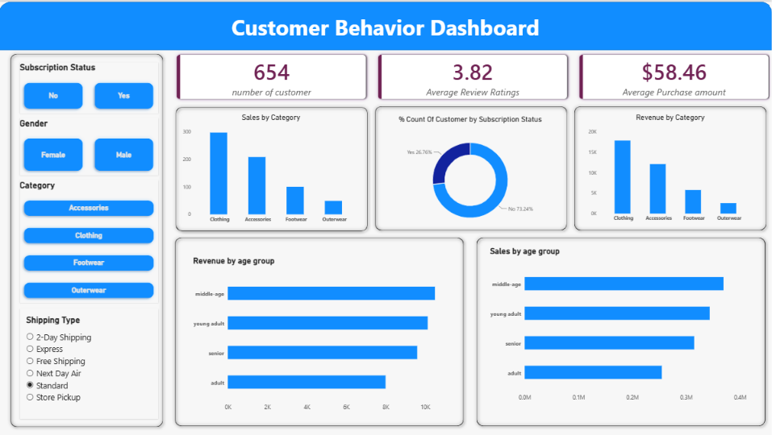

# 🛍️ Customer Shopping Behavior Analysis

## 📌 Project Overview

This project analyzes customer shopping behavior using transactional data containing 3,900 purchase records across different product categories.

The objective is to understand customer purchasing patterns, identify sales trends, analyze customer segments, and generate actionable business insights that can help improve sales, customer satisfaction, and customer loyalty.

This end-to-end Data Analytics project covers the complete workflow, from data cleaning and exploratory data analysis in Python to SQL analysis, Power BI dashboard development, and business reporting.

## 🎯 Business Problem

A retail company wants to better understand its customers' shopping behavior to improve sales, customer engagement, and long-term loyalty.

The project focuses on answering important business questions related to:

- Customer purchasing patterns.
- Revenue across different customer demographics.
- Product preferences and customer ratings.
- Discount usage and purchasing behavior.
- Customer loyalty and subscription trends.
- Sales and revenue across age groups.

## 📂 Dataset

- **Total Records:** 3,900
- **Total Columns:** 18
- **Missing Values:** 37 in the Review Rating column.

**Key Features:**

- Customer Demographics: Age, Gender, Location, Subscription Status.
- Purchase Details: Item Purchased, Category, Purchase Amount, Season, Size, Color.
- Shopping Behavior: Discount Applied, Promo Code Used, Previous Purchases, Frequency of Purchases.
- Customer Experience: Review Rating, Shipping Type.

## 🛠️ Tools & Technologies

| Tool | Purpose |
|---|---|
| Python | Data analysis and cleaning |
| Pandas | Data manipulation |
| Jupyter Notebook | Python development |
| PostgreSQL | Database management |
| SQL | Business data analysis |
| Power BI | Interactive dashboard |
| Gamma | Presentation creation |
| Microsoft Excel | Dataset inspection |

## 🔄 Project Steps

### 1. Data Loading & Exploratory Data Analysis (Python)

- Imported the dataset using Pandas.
- Explored the dataset using `head()`, `info()`, and `describe()`.
- Checked data types and statistical summaries.
- Identified missing values and data quality issues.

### 2. Data Cleaning & Transformation

- Handled 37 missing values in the Review Rating column using the median rating of each product category.
- Standardized column names into snake_case format.
- Created an `age_group` column.
- Created a `purchase_frequency_days` column.
- Checked for redundancy between discount and promo code columns.
- Removed the redundant `promo_code_used` column.

### 3. Database Integration (PostgreSQL)

- Connected Python with PostgreSQL.
- Created the `customer_behavior` database.
- Loaded the cleaned dataset into PostgreSQL.
- Created the `customer` table for further analysis.

### 4. SQL Business Analysis

Performed 10 SQL queries to answer business-related questions.

| No. | Analysis |
|---|---|
| 1 | Revenue generated by male and female customers |
| 2 | High-spending customers who used discounts |
| 3 | Top 5 products based on average review ratings |
| 4 | Average purchase amount by shipping type |
| 5 | Subscribers vs. non-subscribers spending comparison |
| 6 | Products with the highest discount percentage |
| 7 | Customer segmentation: New, Returning, and Loyal |
| 8 | Top 3 most purchased products in each category |
| 9 | Subscription behavior of repeat buyers |
| 10 | Revenue contribution by age group |

**SQL Concepts Used:**

- Aggregate Functions
- GROUP BY and ORDER BY
- Subqueries
- CASE Statements
- Common Table Expressions (CTEs)
- Window Functions
- ROW_NUMBER()

### 5. Power BI Dashboard

Created an interactive **Customer Behavior Dashboard** using Power BI to visualize customer trends and business performance.

#### Dashboard Preview



**Key Performance Indicators (KPIs):**

- Number of Customers
- Average Review Rating
- Average Purchase Amount

**Visualizations:**

- Sales by Category
- Customer Distribution by Subscription Status
- Revenue by Category
- Revenue by Age Group
- Sales by Age Group

**Interactive Filters:**

- Subscription Status
- Gender
- Product Category
- Shipping Type

The dashboard enables users to explore different customer segments and understand purchasing patterns through interactive filters and visualizations.

### 6. Business Report & Presentation

- Prepared a detailed project report highlighting the analysis, SQL findings, dashboard, and business recommendations.
- Created a professional presentation using Gamma to communicate the project workflow, findings, and recommendations.

## 📊 Key Results & Insights

- **Revenue by Gender:** Male customers generated 157,890 in revenue, while female customers generated 75,191.
- **Customer Segmentation:** 3,116 Loyal customers, 701 Returning customers, and 83 New customers.
- **Subscription Analysis:** 1,053 subscribed customers and 2,847 non-subscribers.
- **Shipping Analysis:** Express shipping customers had an average purchase amount of 60.48 compared with 58.46 for Standard shipping.
- **Top-Rated Product:** Gloves received the highest average rating of 3.86.
- **Discount Analysis:** Hats had the highest discount purchase percentage at 50%.

### Business Recommendations

1. **Boost Subscriptions:** Promote exclusive benefits to encourage more customers to subscribe.
2. **Improve Customer Loyalty:** Introduce loyalty programs and rewards for repeat customers.
3. **Optimize Discount Strategies:** Review discount policies to balance sales growth and profitability.
4. **Product Marketing:** Highlight top-rated and best-selling products in marketing campaigns.
5. **Targeted Marketing:** Focus marketing efforts on high-revenue age groups and customer segments.

## 📁 GitHub Repository Structure

```text
Customer-Shopping-Behavior-Analysis/
│
├── PowerBI/
│   ├── Dashboard.pbix
│   └── dashboard.png
│
├── Problem/
│   └── Business Problem  Document.pdf
│
├── Python/
│   └── customer_shopping_behavior_analysis.ipynb
│
├── Report & PPT/
│   ├── Customer Shopping Behavior Analysis.pdf
│   └── Customer-growth-is-hiding-in-loyalty-product-mix-and-subscriptions.pptx
│
├── SQL/
│   └── customer_behavior_analysis.sql
│
├── dataset/
│   └── customer_shopping_behavior.csv
│
└── README.md
```

## ▶️ How to Run the Project

**Step 1: Clone the Repository**

```bash
git clone https://github.com/your-username/Customer-Shopping-Behavior-Analysis.git
```

**Step 2: Install Required Libraries**

```bash
pip install pandas sqlalchemy psycopg2-binary jupyter
```

**Step 3: Load the Dataset**

Open the Python folder and load the CSV dataset from the dataset folder.

**Step 4: Run Python Notebook**

```bash
jupyter notebook
```

Open the Jupyter Notebook and execute the cells to perform data loading, cleaning, transformation, and EDA.

**Step 5: Connect PostgreSQL**

- Configure your PostgreSQL database credentials.
- Create the `customer_behavior` database.
- Run the Python database integration code.
- Load the cleaned data into the `customer` table.

**Step 6: Execute SQL Queries**

Open PostgreSQL pgAdmin or Query Tool and execute the SQL queries available in the SQL folder.

**Step 7: Explore Power BI Dashboard**

Open the `.pbix` file in Power BI Desktop and interact with the dashboard filters and visualizations.

**Step 8: Review Project Deliverables**

Explore the Problem, Report & PPT folders to understand the business requirements, findings, and final recommendations.

## 📌 Project Deliverables

- Python Jupyter Notebook
- Cleaned and analyzed dataset
- SQL business analysis queries
- Interactive Power BI dashboard
- Business problem statement
- Detailed project report
- Gamma presentation

## 👨‍💻 Author

**Sandip Parmar**

Data Analyst

Skills: Python | SQL | PostgreSQL | Power BI | Data Analytics

GitHub: https://github.com/Sandip-78

---

⭐ If you find this project useful, feel free to explore the repository and share your feedback!
